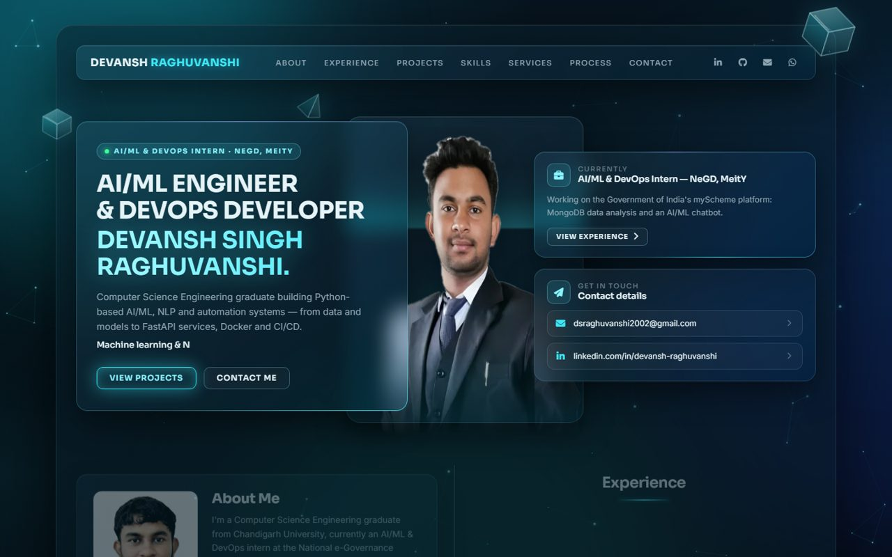
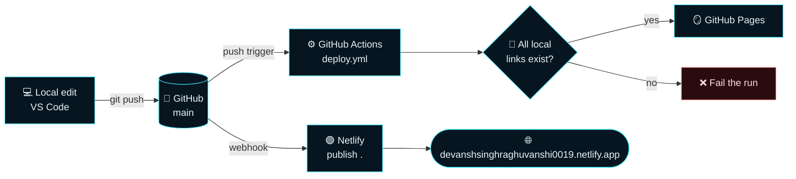

<!-- ===================== HEADER ===================== -->
<p align="center">
  
</p>

<p align="center">
  <a href="https://devanshsinghraghuvanshi0019.netlify.app/">
    
  </a>
</p>

<p align="center">
  <a href="https://devanshsinghraghuvanshi0019.netlify.app/"></a>
  <a href="https://github.com/DSR001915/Portfolio-Personal-Web-Project/actions/workflows/deploy.yml"></a>
  
  
</p>

<h3 align="center">
  <a href="https://devanshsinghraghuvanshi0019.netlify.app/">🌐 Live site</a>
  &nbsp;•&nbsp;
  <a href="https://dsr001915.github.io/Portfolio-Personal-Web-Project/">🪞 GitHub Pages mirror</a>
  &nbsp;•&nbsp;
  <a href="./DevanshResume_AI_ML_DevOps.pdf">📄 Resume</a>
  &nbsp;•&nbsp;
  <a href="https://www.linkedin.com/in/devansh-raghuvanshi-30b578231/">💼 LinkedIn</a>
</h3>

<br>

<p align="center">
  <a href="https://devanshsinghraghuvanshi0019.netlify.app/">
    
  </a>
  <br>
  <sub><i>Click the preview to open the live site — move your mouse over the cards to see the 3D tilt.</i></sub>
</p>


## ⚡ At a glance

<table>
  <tr>
    <td align="center" width="25%"><h3>🎨</h3><b>Glassmorphism UI</b><br><sub>Frosted glass cards, cyan neon edges, floating 3D shapes</sub></td>
    <td align="center" width="25%"><h3>✨</h3><b>Rich motion</b><br><sub>Particle network, 3D tilt, scroll reveals, count-ups</sub></td>
    <td align="center" width="25%"><h3>📱</h3><b>Fully responsive</b><br><sub>Tuned for desktop, tablet and phone — no sideways scroll</sub></td>
    <td align="center" width="25%"><h3>🚀</h3><b>Auto-deployed</b><br><sub>Every push to <code>main</code> goes live on Netlify &amp; Pages</sub></td>
  </tr>
  <tr>
    <td align="center"><h3>🪶</h3><b>~290 KB page</b><br><sub>WebP images, no jQuery or Bootstrap</sub></td>
    <td align="center"><h3>♿</h3><b>Accessible</b><br><sub>Skip link, ARIA labels, honours <i>reduce motion</i></sub></td>
    <td align="center"><h3>🔍</h3><b>SEO-ready</b><br><sub>Meta description &amp; Open Graph tags</sub></td>
    <td align="center"><h3>🧩</h3><b>Zero build step</b><br><sub>Plain HTML, CSS and JavaScript</sub></td>
  </tr>
</table>

## 🧭 What's on the page

```mermaid
flowchart LR
    A([🏠 Hero]) --> B([👤 About])
    B --> C([💼 Experience])
    C --> D([🚀 Featured Projects])
    D --> E([🛠️ Skills & Toolbox])
    E --> F([⚙️ Services & Process])
    F --> G([📦 More on GitHub])
    G --> H([🎓 Certifications])
    H --> I([✉️ Contact])

    classDef sec fill:#071520,stroke:#3ee8f6,stroke-width:1.5px,color:#e6f3f7;
    class A,B,C,D,E,F,G,H,I sec;
```



| Section | What a visitor sees |
|:--|:--|
| 🏠 **Hero** | Name with shimmer, typed focus areas, photo behind a scanning glass panel, “Currently @ NeGD, MeitY” card |
| 👤 **About** | Short bio and animated stats — **8.28 CGPA · 2 internships · 20+ repos** |
| 💼 **Experience** | Self-drawing timeline: **NeGD, MeitY** (AI/ML & DevOps Intern) and **Venura Tech** (AI & ML Intern) |
| 🚀 **Featured Projects** | DocuTrust (corrective RAG), Zenith Study Planner, Churn Prediction, Pneumonia Detection, Face Recognition Attendance |
| 🛠️ **Skills** | Tech tiles, grouped skill chips and a hexagon “Everyday Toolbox” |
| ⚙️ **Services & Process** | AI/ML, Backend & APIs, DevOps — plus a 5-step animated work process |
| 🎓 **Credentials** | IBM DevOps & Software Engineering, AWS Cloud Solutions Architect (with verify links), B.E. CSE |
| ✉️ **Contact** | Validated form, one-click CV download and direct contact links |

## 🎬 Animations & interactions

<details open>
<summary><b>Click to expand / collapse the full list</b></summary>
<br>

| Effect | Where | How it's built |
|:--|:--|:--|
| 🕸️ Particle network | Whole background | `<canvas>` + `requestAnimationFrame`; dots drift away from the cursor |
| 🌌 Aurora glow | Whole background | Blurred gradient blobs with slow keyframe drift |
| 💠 Rotating light border | Hero, “Currently” and CTA cards | Animated `conic-gradient` via `@property --angle` |
| 🧊 3D tilt + spotlight | Every card | Pointer-tracked `rotateX/rotateY` with a radial highlight |
| 🧲 Magnetic buttons | All buttons | Buttons lean toward the cursor; shine sweep on hover |
| 🎞️ Staggered reveals | Tiles, cards, steps, hexagons | `IntersectionObserver` + per-item delays |
| 📈 Count-up stats | About card | Eased number animation on first view |
| ✏️ Self-drawing lines | Timeline, process, section titles | `scaleX/scaleY` transitions on reveal |
| 📊 Scroll progress | Top of the screen | Glowing bar bound to scroll position |
| ⬆️ Back-to-top | Bottom right | Appears after scrolling down |

> [!TIP]
> Motion is **progressive**: phones skip the tilt and cursor effects, and visitors with *Reduce motion* turned on see a calm, fully visible static page.

</details>

## 🧰 Tech stack

<p align="center">
  <a href="https://skillicons.dev">
    
  </a>
</p>

<div align="center">

| Layer | Choice |
|:--:|:--|
| **Markup & styles** | Semantic HTML5 · modern CSS (custom properties, container queries, `backdrop-filter`, `@property`) |
| **Behaviour** | Vanilla JavaScript — no frameworks, no dependencies |
| **Icons & fonts** | Font Awesome 6 · Devicon · Google Fonts (Sora + Inter) |
| **Hosting** | Netlify (primary) · GitHub Pages (mirror via Actions) |

</div>

## 🏗️ How it's built & deployed



## 📂 Project structure

<details>
<summary><b>Show the files that make up the site</b></summary>

```text
📦 Portfolio-Personal-Web-Project
├── 📄 index.html                       # The single-page portfolio
├── 🎨 css/
│   ├── glass.css                       # Glassmorphism theme, layout, responsive rules
│   └── motion.css                      # All animations & interaction styles
├── ⚙️ js/
│   └── main.js                         # Nav, reveals, typing, form, tilt, particles
├── 🖼️ img/
│   ├── dev-cutout.webp                 # Hero portrait (background removed)
│   ├── dev-portrait.webp               # About-card photo
│   └── projects/zenith.webp            # Project screenshot
├── 📑 DevanshResume_AI_ML_DevOps.pdf    # Latest resume
├── 🔀 about.html · skills.html ·        # Redirects from the old multi-page
│   Projects.html · contact.html        #   site to the new sections
├── 🖼️ docs/preview.jpg                  # README screenshot
└── 🤖 .github/workflows/deploy.yml      # GitHub Pages pipeline
```

> Older folders such as `gif/`, `my img/` and `vendors/` belong to the previous version of the site and aren't used by the new page.

</details>

## 🚀 Run it locally

No install, no build — any static server works:

```bash
git clone https://github.com/DSR001915/Portfolio-Personal-Web-Project.git
cd Portfolio-Personal-Web-Project
python -m http.server 5510
```

Then open **http://localhost:5510**.

<details>
<summary><b>✉️ Optional: send contact-form messages without opening the mail app</b></summary>
<br>

By default the form opens the visitor's email app with the message pre-filled.  
To send messages directly, create an [EmailJS](https://www.emailjs.com/) account and paste your keys at the top of `js/main.js`:

```js
const EMAILJS = {
  publicKey: "your-public-key",
  serviceId: "your-service-id",
  templateId: "your-template-id",
};
```

</details>

## 🌟 Featured work shown on the site

<div align="center">

| Project | Highlights | Stack |
|:--|:--|:--|
| [**DocuTrust**](https://github.com/DSR001915/docutrust) | Self-correcting RAG as a LangGraph state machine with reranker grading | FastAPI · LangGraph · ChromaDB · MongoDB |
| [**Zenith Study Planner**](https://zenith-study-planner.vercel.app) | Offline-first planner with calendar, Gantt and Pomodoro | React · TypeScript · Zustand |
| [**Churn Prediction**](https://github.com/DSR001915/Customer-churn-prediction-system) | Stacking ensemble — 98.1% test accuracy, ROC-AUC 0.98 | scikit-learn · XGBoost · LightGBM |
| [**Pneumonia Detection**](https://github.com/DSR001915/pneumoniadetection) | ResNet50 X-ray classifier with Grad-CAM explanations | PyTorch · fastai · Gradio |
| [**Face Recognition Attendance**](https://github.com/DSR001915/Face-recognition-attendance-service) | In-browser face matching for attendance | React · face-api.js · AlaSQL |

</div>


## 🤝 Let's connect

<p align="center">
  <a href="https://www.linkedin.com/in/devansh-raghuvanshi-30b578231/"></a>
  <a href="mailto:dsraghuvanshi2002@gmail.com"></a>
  <a href="https://github.com/DSR001915"></a>
  <a href="https://devanshsinghraghuvanshi0019.netlify.app/"></a>
</p>

<p align="center">
  <sub>If you like the design, leave a ⭐ — it helps others find it.</sub>
</p>


